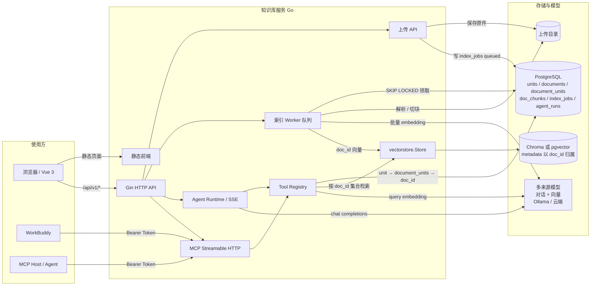
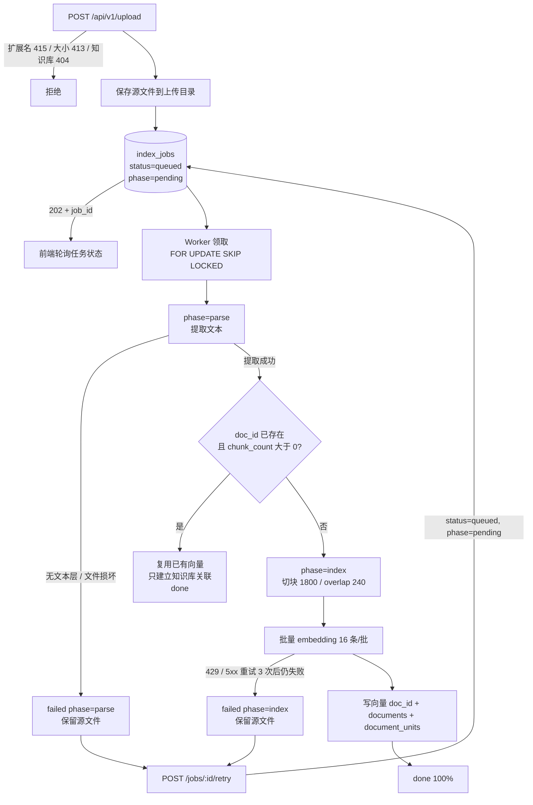
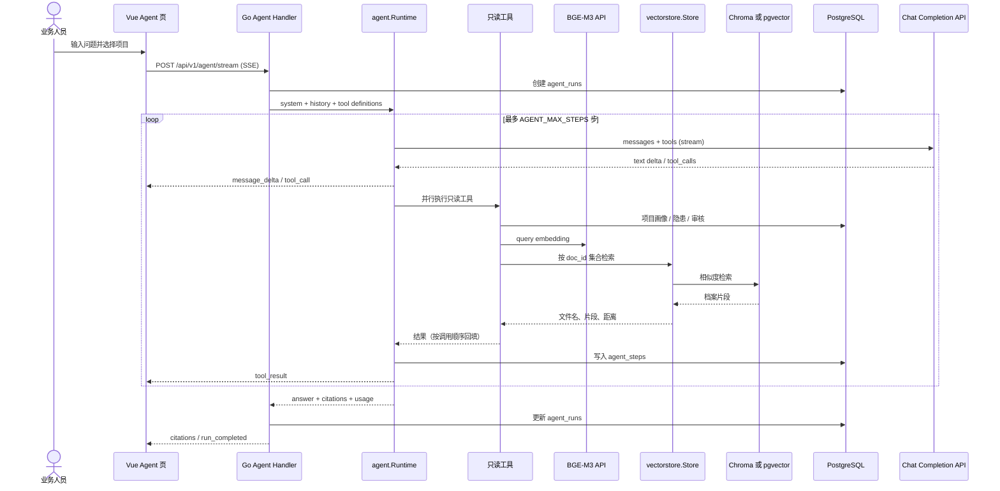
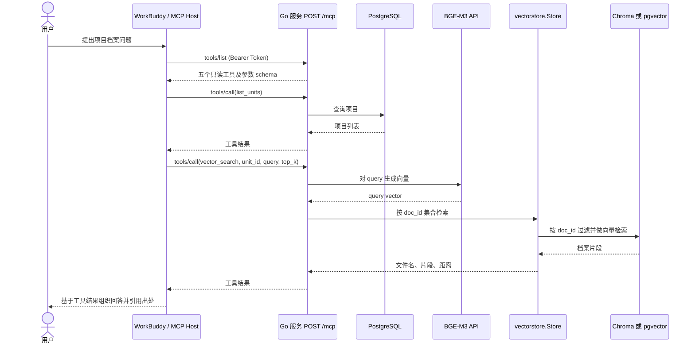
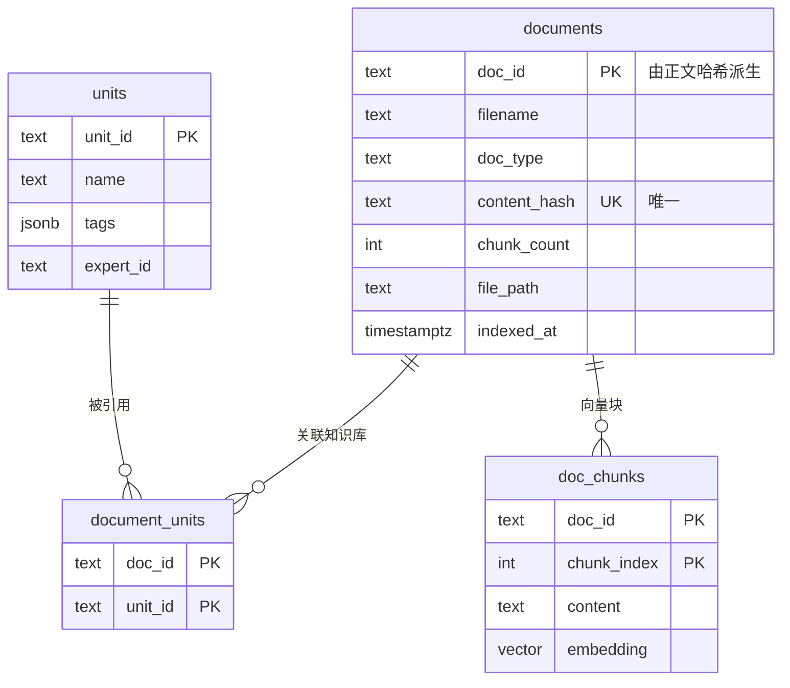

# 开发与部署手册

## 1. 技术栈与模块边界

### 1.1 系统架构图



`vectorstore.Store` 是向量库替换边界（pgvector / Chroma v2）。文档是独立实体：`documents(doc_id)` + `document_units(doc_id, unit_id)` 表达「一份文档可被多个知识库引用」，向量只按 `doc_id` 存一份。检索时先把知识库集合翻译成 `doc_id` 集合，再过滤向量库。模型配置支持多来源（`model_providers` + `model_selection`），对话与向量可分别指向不同端点（本地 Ollama 或云端）。内置 Agent 与 MCP 复用同一组工具实现，但分别走 `/agent/*` 与 `/mcp`。

### 1.2 上传与索引流程（上传 → 解析 → 索引）



任务分三个阶段，`index_jobs.phase` 记录当前阶段，失败时停留在出错阶段（前端显示「解析失败」或「索引失败」）：

| phase | progress | 说明 |
|---|---|---|
| `pending` | 0 | 已上传、排队等待 worker |
| `parse` | 5–10 | 解析文本（PDF 优先 `pdftotext`，回退纯 Go；扫描件无文本层则失败） |
| `index` | 25–95 | 切块、批量 embedding、写向量与文档记录 |
| `done` | 100 | 完成 |
| `failed` | 保留 | 保留出错阶段与原因，源文件不删，可重试 |

上传本身**不做解析**，任何白名单格式都返回 202；解析与索引失败只体现在任务状态里。同样的正文（`content_hash` 派生 `doc_id`）重复上传时，任务会识别出已存在的文档，只建立 `document_units` 关联并复用向量，不重复解析与 embedding。同一知识库下同名但内容不同时，旧版本会被自动解绑并在无其他引用时清理。

队列语义：worker 每 2 秒轮询 + 上传后 `wakeWorker()` 立即触发；`attempts` 限制同一任务被领取的次数，进程重启只回收超过「任务超时 + 1 分钟」的陈旧 `running` 任务，避免多实例互抢；同一 `unit_id + filename` 由进程内文件锁串行处理。`INDEX_CONCURRENCY` 可调并发（默认 1，上限 4）。

### 1.3 Agent 工具循环与流式回答



- `/api/v1/agent/chat` 与 `/api/v1/agent/stream` 共用同一个运行时；前者聚合结果返回 JSON，后者通过 SSE 推送 `run_started`、`step_started`、`tool_call`、`tool_result`、`message_delta`、`citations`、`run_completed`、`error` 事件。SSE 每 15 秒发送 `: keep-alive` 注释帧，避免反向代理在工具/模型执行期间断开。
- 选择项目时，运行时按**第一个**项目的 Agent/技能/工具绑定裁剪只读工具：候选为 `get_unit_profile`、`query_hazards`、`audit_history`、`vector_search`；项目显式声明的 `tool_names` 优先，未声明时由技能声明所需工具、Agent 作为上限，两边都未声明时全部启用。对话支持同时选择多个项目，工具的 `unit_id` 参数枚举限定在已选集合内，不传时覆盖全部已选项目，结果带 `unit_id`/`unit_name`；模型无法查询集合外的项目。
- 每步工具调用先做参数校验，再并行执行，结果按模型请求顺序回填；工具错误作为 tool result 返回给模型，而不是中断整个对话。模型因输出长度被截断时（`finish_reason=length`），该批 tool call 全部判为失败且不执行——流式拼接出的参数可能"看着合法但实际不完整"。
- `web_search` 是可选的外部工具，需要「服务端配置联网搜索」+「本轮请求 `web_search: true`」同时满足；不受项目 `tool_names` 约束。搜索结果可通过 `POST /units/:id/web-import` 归档进项目：抓取正文（`internal/websearch/fetch.go`，SSRF 防护：仅公共 http(s)、拨号时复检 IP、重定向逐跳复检、4MB 上限、仅文本类响应）后写入上传目录并复用 `index_jobs` 队列，因此与上传共享重试、进度和重启续跑语义。实现在 `internal/websearch`（provider 可插拔：tavily / bocha / brave），带结果缓存、站点白/黑名单、超时与查询长度限制；结果以 `notice` 明确标注为不可信外部内容，引用以 `source_type: "web"` 单独呈现，与已入库档案分开。
- `vector_search` 在工具内部按约 20KB 预算裁剪片段，citations 只包含实际发送给模型的片段；Agent Loop 的兜底截断为 24KB，用于其他可能较大的工具结果。
- 模型流式调用支持 tool_calls；若 provider 拒绝流式工具调用（400/422），自动回退到非流式请求。模型返回空文本且无工具调用时按失败处理，不返回空回答。
- 运行状态写入 `agent_runs`：`completed`、`failed`、`cancelled`、`timeout`、`max_steps`；服务启动时仅把超过 Agent 最大运行时限的陈旧 `running` 标记为 `interrupted`，避免误改其他实例正在运行的记录。工具明细写入 `agent_steps`，写失败只记日志。
- 未选择项目时不暴露工具，直接进行通用对话。
- `/api/v1/ask` 仍是单轮检索 + 回答的兼容接口，不进入工具循环。
- 远程 connector 目前仍只描述/展示，尚未实现外部 MCP client 工具调用。

### 1.4 WorkBuddy / 外部 Agent 的 MCP 调用流程



生产接入应在 MCP endpoint 前使用 HTTPS，并为调用方配置有效 Bearer Token。MCP 工具当前只读；工具结果的最终回答由外部 Agent 生成。

```text
Vue 3 / Vite
  └─ /api/v1/* ── Go + Gin (cmd/server, internal/app)
                    ├─ pgx ── PostgreSQL (units / hazards / audit_records)
                    ├─ vectorstore.Store ── pgvector / Chroma adapters (document vectors)
                    ├─ OpenAI-compatible API ── BGE-M3 embeddings / chat model
                    └─ POST /mcp ── WorkBuddy / other MCP hosts
```

- `cmd/server`：读取端口并启动 HTTP 服务。
- `internal/app`：HTTP API、上传任务与 `index_jobs` 持久化、文档提取与切块、模型调用、Agent HTTP/SSE 适配和 MCP 工具。
- `internal/agent`：与 HTTP/数据库无关的 Agent 运行时，包括工具注册、并行工具循环、事件流和 OpenAI-compatible 流式工具客户端。
- `internal/logging`：`slog` 初始化、`app.log`/`access.log`/`error.log` 分流与按大小轮转。
- `internal/vectorstore`：`Store` 接口、provider 选择、pgvector 与 Chroma adapters。
- `frontend/src`：Vue 页面；生产静态资源从 `frontend/dist` 提供。
- `deploy/schema.sql`：PostgreSQL 业务表 schema，不依赖 pgvector 扩展。
- `deploy/schema-pgvector.sql`：仅选择 `VECTOR_STORE=pgvector` 时创建向量表。
- `workbuddy/knowledge-base-connector`：WorkBuddy connector 源包；zip 在同目录父级。

### 1.5 数据模型关系（文档中心）



- `documents` 以正文哈希派生 `doc_id`，`content_hash` 上有唯一索引，同样的内容只存一份。
- `document_units` 是多对多：从知识库删除文档只删这一行；不再被任何知识库引用时才清理向量与源文件。
- `doc_chunks`（pgvector 模式）或 Chroma metadata 以 `doc_id` 归属，文件名与类型来自 `documents`。
- `index_jobs` 记录任务与源文件路径，供重试与重索引使用。

### 前端设置导航

全局侧栏底部的「设置」进入设置布局，设置页内部分类导航包含：

| 分类 | 路由 | 用途 |
| --- | --- | --- |
| 模型服务 | `/settings/models` | 分别配置向量模型与对话模型 |
| 联网搜索 | `/settings/web-search` | 配置搜索服务、站点范围与缓存限制 |
| Agent 与技能 | `/settings/agents` | 上传与管理 Agent、技能定义 |

Agent 与技能管理不再作为全局侧栏一级菜单；原 `/agents` 路由保留为到 `/settings/agents` 的重定向。设置布局在宽屏下显示固定的左侧分类导航和独立滚动的右侧内容面板，在窄屏下将分类导航切换为顶部横向菜单。模型服务、联网搜索的页内 Tab 在右侧内容滚动时保持可见。

当前代码中 `VECTOR_STORE` 支持 `pgvector` 和 `chroma`。Chroma adapter 连接时会确保目标 collection 存在；通过 `CHROMA_URL`、`CHROMA_TENANT`、`CHROMA_DATABASE`、`CHROMA_COLLECTION` 配置。Chroma 存储由应用侧生成的 BGE-M3 embeddings，使用 `unit_id` metadata filter 做隔离检索。新增 provider 时实现 `Upsert`、`Search`、`Count`、`DeleteFrom`，并在 provider factory 中注册，不能把特定数据库逻辑泄漏到 API handler。

## 2. 本地开发环境

需要 Go 1.23+、Node.js 20+、pnpm 10+ 和 PostgreSQL 15+。

数据落点：

- 业务数据 `units`、`hazards`、`audit_records`、`index_jobs`、`documents` 始终通过 `PG_DSN` 存入 PostgreSQL。
- 向量写入由 `VECTOR_STORE` 决定：本地开发用 `chroma`，需先启动 Chroma（默认 `http://127.0.0.1:8000`，启动时 `get_or_create` collection，Chroma 不可用会导致服务启动失败）；线上可改为 `pgvector`，此时在同一个 PostgreSQL 中创建 `doc_chunks`，需安装 pgvector 扩展并执行 `deploy/schema-pgvector.sql`。
- 两种 provider 使用相同 embedding 模型和 1024 维向量，切换 provider 时必须重建向量索引。

PDF 无需额外依赖：优先用 `pdftotext`（排版与中文更准），没有时走内置纯 Go 解析。复制 `.env.example` 到 `.env` 并填写连接信息和模型凭据；不要提交 `.env`。

```sh
psql "$PG_DSN" -f deploy/schema.sql
# 仅 VECTOR_STORE=pgvector 时额外执行：
# psql "$PG_DSN" -f deploy/schema-pgvector.sql
cd frontend && pnpm install
```

### 启动 Chroma（OrbStack k8s）

本项目的 Chroma 跑在 OrbStack 的 k8s 里（`knowledge-base` 命名空间，Deployment/Service 同名 `chroma`，PVC `chroma-data` 持久化到 `/data`）。它的 Service 是 ClusterIP，**集群外无法直连，必须做端口转发**——转发进程一断，`127.0.0.1:8000` 就不通，Go 服务启动会直接失败并报 `initialize Chroma collection ... connection refused`。

服务启动前先确保转发在跑：

```sh
# 1. 确认 Pod 活着（不是 Running 先排查镜像拉取/探针）
kubectl -n knowledge-base get pod,svc,pvc

# 2. 首次部署（清单在 ./chroma-k8s.yaml）
kubectl apply -f ./chroma-k8s.yaml
kubectl -n knowledge-base rollout status deploy/chroma

# 3. 常驻转发（放后台，另开终端会被中断）
nohup kubectl -n knowledge-base port-forward svc/chroma 8000:8000 > /tmp/chroma-pf.log 2>&1 &
sleep 2
curl -s localhost:8000/api/v2/heartbeat     # 应返回 {"nanosecond heartbeat":...}
```

三种运行位置对应的地址：

| 后端在哪跑 | 转发命令 | `.env` 的 `CHROMA_URL` |
| --- | --- | --- |
| mac 本机 | `port-forward svc/chroma 8000:8000` | `http://127.0.0.1:8000` |
| OrbStack 容器里（推荐，免转发） | **不需要** | `http://<CLUSTER-IP>:8000`，用 `kubectl -n knowledge-base get svc chroma` 查 |
| OrbStack 容器里（走 mac 转发） | `port-forward --address 0.0.0.0 svc/chroma 8000:8000` | `http://host.docker.internal:8000` |
| k8s 集群内 | 不需要 | `http://chroma.knowledge-base.svc:8000` |

**实测：OrbStack 容器可以直接访问 Service 的 ClusterIP**（`curl http://192.0.2.10:8000/api/v2/heartbeat` 返回 `{"nanosecond heartbeat":...}`），所以后端跑在容器里时根本不用转发，把 `CHROMA_URL` 填成 ClusterIP 即可。缺点是 ClusterIP 在 Service 重建后会变；要固定地址就把 Service 改成 `type: NodePort`（指定 `nodePort: 30800`），一劳永逸。

mac 本机跑后端时仍需转发（默认监听 `127.0.0.1`，只对 mac 生效；后端在容器里则必须加 `--address 0.0.0.0`）。

终端 A 启动后端：

```sh
go run ./cmd/server   # 自动加载工作目录下的 .env，无需 source
```

启动器会在初始化日志前读取 `.env`：已存在的进程环境变量优先，不会被文件覆盖；文件不存在时静默跳过（线上由 systemd `EnvironmentFile` 注入即可）。需要指定其他文件时设置 `ENV_FILE=/path/to/env`。

终端 B 启动前端开发服务器：

```sh
cd frontend
pnpm dev
```

Vite 将 `/api`、`/health`、`/mcp` 代理到 `http://localhost:8081`（`vite.config.ts` 的 `proxy` 目标必须与 `.env` 里的 `PORT` 一致）。生产构建和启动：

```sh
cd frontend && pnpm build && cd ..
go run ./cmd/server
```

前端依赖统一用 pnpm，不要与 npm 混用。三个 pnpm 特有的坑：

| 现象 | 原因 | 处理 |
| --- | --- | --- |
| `Failed to resolve entry for package "@vue-office/docx"` | 这三个包的 `lib/index.js` 由 `postinstall` 生成，pnpm 默认不执行依赖构建脚本 | `package.json` 的 `pnpm.onlyBuiltDependencies` 已批准相关包；仍报错时执行 `pnpm rebuild` |
| 打包报 `Rollup failed to resolve import "three"` | pnpm 不提升传递依赖，`3d-force-graph` 的 `three` 不在顶层 | `three` 已在 `dependencies` 显式声明 |
| `Cannot find module @rollup/rollup-linux-arm64-gnu` | 锁文件只含当前平台的原生二进制 | `pnpm.supportedArchitectures` 已声明多平台；换平台后执行 `pnpm install` |

`@vue-office/*` 是 UMD 包，`vite.config.ts` 用 `optimizeDeps.include` 强制预构建；若改为 `exclude`，dev 下会直接加载未转换的 CJS，预览报 `defineComponent of undefined`。

Go 服务默认监听 `127.0.0.1:${PORT}`，默认 8080；可通过 `LISTEN_ADDR` 覆盖。远程部署应经受控 HTTPS 反向代理访问。确保进程工作目录能访问 `frontend/dist`。

## 3. 环境变量

| 变量 | 用途 | 默认/要求 |
| --- | --- | --- |
| `ENV_FILE` | 启动时加载的环境文件路径 | `.env`；不存在则跳过 |
| `PORT` | HTTP 监听端口（未设置 `LISTEN_ADDR` 时生效） | `8080` |
| `LISTEN_ADDR` | HTTP 监听地址 | `127.0.0.1:${PORT}`；远程部署时按需设为 `0.0.0.0:8080` |
| `PG_DSN` | PostgreSQL 连接串 | 业务数据必填（Chroma 与 pgvector 模式都需要） |
| `VECTOR_STORE` | 向量 provider | `chroma`（本地 `.env`）或 `pgvector`（线上）；代码默认 `pgvector` |
| `CHROMA_URL` | Chroma v2 HTTP API 根地址 | 使用 Chroma 时默认 `http://localhost:8000` |
| `CHROMA_TENANT` | Chroma tenant | `default_tenant` |
| `CHROMA_DATABASE` | Chroma database | `default_database` |
| `CHROMA_COLLECTION` | 档案向量 collection | `knowledge_base` |
| `UPLOAD_DIR` | 原始上传文件目录 | `./data/uploads` |
| `MAX_UPLOAD_MB` | 单文件上传大小上限 | `20` |
| `INDEX_TIMEOUT_MINUTES` | 单个索引任务超时 | `15` |
| `EMBED_BASE_URL` | OpenAI-compatible embedding API 根地址 | 必填，例如服务商 `/v1` 根地址；页面保存值优先 |
| `EMBED_API_KEY` | embedding API 凭据 | 必填；页面保存值优先 |
| `EMBED_MODEL` | embedding 模型名 | `BAAI/bge-m3`；维度固定 1024 |
| `LLM_BASE_URL` | OpenAI-compatible chat API 根地址 | Agent/ask 必填；页面保存值优先 |
| `LLM_API_KEY` | chat API 凭据 | Agent/ask 必填；页面保存值优先 |
| `LLM_MODEL` | chat 模型 | `Qwen/Qwen2.5-7B-Instruct` |
| `MCP_AUTH_TOKEN` | MCP Bearer 凭据 | 访问 MCP 时必须配置；空值会禁用 endpoint |
| `AGENT_MAX_STEPS` | 单次 Agent 运行最多工具步数 | `6`（允许 1–12） |
| `WEB_SEARCH_ENABLED` | 是否启用联网搜索（服务端开关） | `false` |
| `WEB_SEARCH_PROVIDER` | 搜索服务：`tavily` / `bocha` / `brave` | 空（启用时必填） |
| `WEB_SEARCH_API_KEY` | 搜索服务密钥 | 空（启用时必填，不落日志） |
| `WEB_SEARCH_BASE_URL` | 自建或代理地址 | 空（用各服务默认地址） |
| `WEB_SEARCH_TIMEOUT_MS` | 单次搜索超时 | `15000` |
| `WEB_SEARCH_CACHE_TTL_SECONDS` / `WEB_SEARCH_CACHE_ENTRIES` | 结果缓存时长与条数 | `900` / `200` |
| `WEB_SEARCH_ALLOW_DOMAINS` / `WEB_SEARCH_DENY_DOMAINS` | 站点白名单/黑名单（逗号分隔） | 空（不限制站点） |
| `AGENT_EXPERTS_JSON` | 专家定义数组（基线） | 可选；页面上传的定义覆盖同 id 项，格式见下文 |
| `AGENT_SKILLS_JSON` | 技能定义数组（基线） | 可选；页面上传的定义覆盖同 id 项，格式见下文 |
| `MCP_CONNECTORS_JSON` | Agent UI 展示的 connector 描述数组 | 可选；目前仅描述，不会被 chat handler 调用 |
| `LOG_DIR` | 日志目录 | `./logs`；生产建议 `/var/log/knowledge-base` |
| `LOG_LEVEL` | 日志级别 | `debug`/`info`/`warn`/`error`，默认 `info` |
| `LOG_FORMAT` | 日志格式 | `text`（默认）或 `json` |
| `LOG_CONSOLE` | 是否同时输出到 stdout | `true`；systemd 下进入 journald |
| `LOG_MAX_SIZE_MB` | 单文件轮转阈值 | `50`；`0` 表示不轮转 |
| `LOG_MAX_BACKUPS` | 每类日志保留的轮转文件数 | `10` |

示例（写入 `.env` 时必须用单引号包裹，否则 `source .env` 时 shell 会对 JSON 中的花括号/逗号做展开；直接作为进程环境变量时可省略引号）：

```sh
AGENT_EXPERTS_JSON='[{"id":"kb-expert","name":"知识库专家","description":"知识库问答","system_prompt":"依据档案回答，缺少证据时说明。","tools":["get_unit_profile","query_hazards","audit_history","vector_search"]}]'
AGENT_SKILLS_JSON='[{"id":"archive-search","name":"档案检索","description":"检索项目资料","instructions":"引用检索到的文件名。","tools":["vector_search"]}]'
MCP_CONNECTORS_JSON='[{"name":"kb-mcp","url":"https://kb.example.com/mcp","enabled":true}]'
```

### 3.1 日志规则

日志统一由 `internal/logging` 初始化，使用标准库 `log/slog`，不直接调用 `log.Printf`。

| 文件 | 写入内容 | 级别 |
| --- | --- | --- |
| `app.log` | 启动/停止、索引任务阶段与耗时、Agent run 完成（`run_id`/`steps`/`citations`）、数据库和模型错误、MCP 工具错误 | `LOG_LEVEL` 及以上 |
| `access.log` | 每个 API/页面请求一行：`request_id`、`method`、`path`、`status`、`latency_ms`、`ip`、字节数；`/assets/*` 静态资源不记录，`/health` 仅在 DEBUG 级别记录 | `LOG_LEVEL` 及以上 |
| `error.log` | `app.log` 与 `access.log` 中的 ERROR 记录汇总 | 仅 ERROR |

约定：

- 每个响应返回 `X-Request-ID`；请求可自带该头，服务会透传，否则生成 16 位十六进制 ID。
- 业务日志按场景绑定字段：索引任务带 `job_id`/`unit_id`/`filename`/`doc_type`/`duration_ms`/`chunks`，Agent 带 `run_id`/`unit_id`/`expert`/`skills`/`steps`/`citations`，MCP 带 `tool`/`unit_id`/`duration_ms`，HTTP 带 `request_id`/`status`。工具级 trace 写入 `agent_steps`，不只依赖日志。
- 记录查询字符串以外的请求路径，不记录 query string；禁止记录 API key、MCP token、密码和档案正文。
- `LOG_FORMAT=json` 用于日志采集；默认 `text` 便于本地阅读。文件超过 `LOG_MAX_SIZE_MB` 轮转为 `<name>-YYYYMMDD-HHMMSS.mmm.log`，保留 `LOG_MAX_BACKUPS` 个。
- 控制台输出由 `LOG_CONSOLE` 控制；日志目录初始化失败时进程回退到 stderr，不会因日志目录不可写而退出。

## 4. 数据库初始化与数据模型

```sh
psql "$PG_DSN" -f deploy/schema.sql
# 仅 VECTOR_STORE=pgvector 时额外执行：
psql "$PG_DSN" -f deploy/schema-pgvector.sql
```

`schema.sql` 会创建以下业务表；本地 Chroma 模式只需要执行它，无需 PostgreSQL 向量扩展。使用 pgvector 时，`schema-pgvector.sql` 会创建 `doc_chunks` 向量表及索引：

- `units`：项目主数据；`unit_type` 为项目分类、`industry` 为行业，`tags` 保存项目标签（用于筛选、画像与关联图谱），`expert_id`/`skill_ids`/`tool_names` 保存项目级 Agent、技能与显式工具（对话时自动套用，`tool_names` 优先于按技能推导）。上传文档前必须存在对应 `unit_id`。
- `agent_experts` / `agent_skills`：页面上传的 Agent 与技能定义（id、名称、说明、system_prompt/instructions、tools、来源、时间）。内置定义与环境变量作为基线，同 id 的上传记录优先；`tools` 只能取四个只读工具，用于裁剪对话时的工具集。
- `doc_chunks`（pgvector 可选）：文档 `doc_id`、chunk 序号、文本及 `vector(1024)`；主键为 `(doc_id, chunk_index)`。文件名与类型来自 `documents`，一份文档被多个知识库引用时只存一份向量。
- `hazards`：项目隐患和状态。
- `audit_records`：项目审核记录、分数、风险级别及 JSON payload。
- `index_jobs`：持久化索引任务队列（`job_id`、项目、文件名、源文件路径 `file_path`、状态、进度、chunk 数、重试次数 `attempts`、时间戳）。上传只写入 `queued` 行，worker 通过 `FOR UPDATE SKIP LOCKED` 领取并执行；服务启动时仅把超过索引超时阈值的陈旧 `running` 任务重新置为 `queued`，避免另一个活跃实例的任务被抢占。
- `documents`：文档一等实体（`doc_id` 由正文哈希派生、文档类型、`job_id`、chunk 数、内容哈希、源文件路径、索引时间）；`content_hash` 上有唯一索引，同内容只存一份。
- `document_units`：文档 ↔ 知识库的多对多关系；知识库相当于带标签的分组，从知识库移除只删这一行。
- `web_search_settings`：联网搜索单行配置（开关、provider、密钥、超时、缓存、站点白/黑名单、自动入库开关）。数据库记录优先于 `WEB_SEARCH_*` 环境变量，保存后缓存失效并重建搜索客户端，密钥只掩码回显。
- `documents.source_url` / `index_jobs.source_url`：网页入库的来源 URL，用于去重与溯源；普通上传为空字符串。
- `agent_runs`：Agent 运行记录（`run_id`、项目、专家、用户原始问题、技能、状态、步数、token、错误、起止时间）。旧记录缺少问题时，运行详情接口会按 `run_id` 从关联的用户消息回填。
- `agent_steps`：工具调用明细（`run_id`、步号、工具名、参数、结果预览、耗时、错误）。写入失败只记日志，不影响对话。
- `agent_conversations` / `agent_messages`：对话历史。会话记录项目（`unit_ids` 保存多选集合，`unit_id` 冗余第一个项目）、Agent、标题与更新时间；消息记录角色、内容、引用（jsonb）和 `run_id`。删除会话级联删除消息，历史写入失败同样只记日志。
- `model_settings`：模型服务配置单行表（`id=1`），保存 embedding/chat 的 `base_url`、`api_key`、`model`。字段为空时回落到 `EMBED_*`/`LLM_*` 环境变量，因此已有部署无需初始化该表。API Key 与其它数据同样以明文存储在该表中，读取接口只返回掩码；生产环境应限制数据库访问权限。

原附件还提到 `findings`、`ledger_results` 以及 Python 线 A/线 B 脚本，但这些对象当前没有随本仓库实现。接入旧数据前，应先核实源 SQL、字段和迁移规则；不要假设当前 schema 与既有脚本完全兼容。

项目样例可按需人工插入：

```sql
INSERT INTO units(unit_id,name,unit_type,industry)
VALUES ('demo-001','示例项目','重点项目','制造业')
ON CONFLICT (unit_id) DO NOTHING;
```

## 5. 文档索引流程

```text
POST /api/v1/upload
  → 校验数据库、unit_id/unit_name、doc_type、文件字段、扩展名和大小上限
  → unit_name 未匹配到项目时自动创建（unit-<hex>）
  → 保存原文件到 UPLOAD_DIR/<unit_id>/<job_id>_<filename>
  → 写入 index_jobs(queued)，返回 202 + job_id，后台进程内 goroutine 执行
  → 提取纯文本 (DOCX 解包 XML；PDF 优先 pdftotext，否则内置 Go 解析)
  → 按 1800 字符切块、240 字符重叠
  → 每批最多 16 段请求 EMBED_MODEL，校验返回数量与每个向量是否为 1024 维
  → vectorstore.Store.Upsert 写入并更新 index_jobs 进度
  → DeleteFrom(unit_id, filename, chunk_count) 删除上一版本尾部 chunk
  → 写入 documents 版本记录
```

当前切块按 Unicode rune 计数，不理解 PDF 页码、DOCX 标题或表格结构；DOCX 表格内容是否完整取决于 XML 文本顺序。PDF 扫描件不会自动 OCR。任务状态持久化在 `index_jobs`，服务启动时超过索引超时阈值的陈旧 `running` 任务会重新排队；单任务最多尝试 3 次，处理错误会直接失败。领取任务使用 `SKIP LOCKED`，启动恢复也会避开未超时的任务；同一文档的文件锁仍是进程级，多副本同时重建同一文件时仍需分布式锁。

上传时先按正文哈希判断文档是否已存在：已存在则跳过解析与向量化，只建立 `document_units` 关联（响应直接返回 `done`）；不存在才走完整索引。同一知识库下同名但内容不同时，旧版本会被自动解绑并清理。索引结构变更后可用 `go run ./cmd/reindex` 重建全部向量。chunk 写入与 `documents` 记录不在同一事务内；`documents` 写失败会将任务标记为 `failed`，但已写入的向量可能部分覆盖旧版本。完整解决需要版本化向量与发布切换机制。

## 6. HTTP API

详细契约见 [API 参考](api.md)。关键行为：

- API 基础路径为 `/api/v1`；上传为 multipart。
- `/api/v1/ask` 和 `/api/v1/agent/chat` 使用 embedding 与 chat 服务，均返回 `citations`。
- `/api/v1/agent/stream` 使用同一 Agent 运行时，以 SSE 推送工具调用、文本增量和引用；详细事件见 `docs/api.md`。
- `/health` 的 `database` 字段只反映是否配置了 PG pool，不代表数据库当前连通性探测成功。
- 错误响应通常为 `{"error":"..."}`；上传任务状态查询对未知 job 返回 404。
- `DELETE /api/v1/units/:id/documents/:filename` 删除一份文档的向量、`documents` 记录和源文件。

## 7. MCP 与 WorkBuddy

服务端 MCP endpoint 为 `POST /mcp`，使用 Bearer token。实现了 `2026-07-28` 无状态协议路径及 `2025-11-25` 兼容路径；工具均只读：

| Tool | 用途 |
| --- | --- |
| `list_units` | 列出可用项目 |
| `get_unit_profile` | 返回项目基础信息及审核、开放隐患、索引 chunk 数 |
| `query_hazards` | 查询项目隐患，可按状态过滤 |
| `audit_history` | 读取项目审核历史 |
| `vector_search` | BGE-M3 编码问题并返回项目档案相似片段 |

内置 Agent 复用同一组数据查询函数（`unitProfile`、`queryHazards`、`auditHistory`、`searchChunks`），但 Agent 工具 Schema 不包含 `unit_id`（由服务端固定），MCP 工具仍要求调用方显式传入 `unit_id`。

本地可以将 connector 包里的 `mcp.json` URL 改为已部署服务地址；远程生产环境只用 HTTPS。服务端 `MCP_AUTH_TOKEN` 必须与连接器用户配置一致。连接器 token 不应写入打包文件或仓库。

本地 Agent 页面的 `MCP_CONNECTORS_JSON` 当前用于描述/展示 connector。它不代表后端已经实现任意 MCP client、工具发现、工具调用和结果回传；该执行能力需作为后续功能独立开发和验收。

## 8. Ubuntu / systemd 部署

1. 安装 Go、Node 与 pnpm 10+（仅构建前端时需要）、PostgreSQL 客户端（`pdftotext` 可选，装了 PDF 解析更准）。
2. 将源码部署到固定目录，用 `cd frontend && pnpm install && pnpm build` 构建 `frontend/dist`，再构建 Go 二进制（跨平台部署时交叉编译，例如 `GOOS=linux GOARCH=arm64 go build -o bin/knowledge-base ./cmd/server`）。
3. 从安全渠道写入 `/etc/knowledge-base/env`，限制为仅服务用户可读（例如 `0600`）。至少配置 `PG_DSN`、embedding/chat 密钥和 MCP token。
4. 确认服务用户有 `UPLOAD_DIR` 和 `LOG_DIR` 写权限，例如 `install -d -o knowledgebase -g knowledgebase /var/log/knowledge-base` 并在 env 中设置 `LOG_DIR=/var/log/knowledge-base`；`deploy/knowledge-base.service` 已把该目录加入 `ReadWritePaths`。执行 schema 迁移并确保 PG 网络可达。
5. 按部署路径调整 `deploy/knowledge-base.service` 中的 `WorkingDirectory` 和二进制路径，再启用服务。
6. 通过反向代理提供 HTTPS；开放 MCP 给 WorkBuddy 前测试 token、网络 ACL 和项目数据访问范围。
7. 验收 `/health`、项目查询、一次脱敏文件上传、向量检索、Agent SSE 工具循环和 WorkBuddy 工具调用。

## 9. 开发规范与变更约束

- 新 API 在 `internal/app` 注册路由，并同步更新 `docs/api.md`。
- 新增只读能力时，优先实现为 `internal/app` 的工具（`agentTool`），并在 `agentRegistry` 中暴露给 Agent；需要外部复用时同步加入 MCP `mcpTools`，保持两处参数语义一致。
- 改 schema 时同步更新 `deploy/schema.sql`、此文档和迁移/备份说明；生产库变更应使用可回滚迁移，不能仅依赖 `CREATE TABLE IF NOT EXISTS`。
- 新向量数据库实现 `vectorstore.Store`，覆盖 provider 选择和 provider 配置说明；相似度排序、项目过滤、维度校验语义需一致。
- 改 embedding 模型、维度、归一化或切块参数时，应通过版本化索引重建，不能混写不兼容向量。
- 新增日志统一使用 `internal/logging.App()` / `internal/logging.HTTP()` 和 `slog` 结构化字段，不新增 `log.Printf`；需要文件分流或轮转规则时改 `internal/logging`，不要在业务代码里自行打开文件。
- 不把密钥、真实档案、个人信息写入日志、前端 bundle、示例配置或 connector zip。
- 新增功能需补充自动化测试。仓库现有单元测试覆盖切块、文档提取、上传校验、任务状态、Agent 工具循环/并行顺序/最大步数/空回答、向量工具预算与引用对齐、OpenAI 流式解析/非流式回退、MCP 鉴权/协议以及 Chroma adapter（基于 httptest 的伪服务）；数据库查询路径仍以集成测试为主，需在真实 PostgreSQL 上补充覆盖。

```sh
go test ./...
go vet ./...
```

Chroma adapter 的本地集成检查（会创建并在结束时删除唯一命名的临时 collection）：

```sh
CHROMA_URL=http://localhost:8000 CHROMA_INTEGRATION_TEST=1 go test ./internal/vectorstore -run TestChromaIntegration -v
```

## 10. 已知限制与下一步建议

1. 为 chunk 写入与 `documents` 记录补充事务；任务队列已持久化并使用 `SKIP LOCKED` 抢占，worker 为单协程串行消费；向量写入与 `documents` 元数据目前跨存储，尚无版本化发布/回滚机制。
2. 增加 MIME 内容嗅探（目前只校验扩展名）、请求级并发上限和更细的限流。
3. 为数据库连接池、MCP 项目级授权、用户登录和操作审计补上生产安全能力。
4. 根据真实审核数据实现正式画像分数、风险档位和审核 JSON 导入。
5. 建立 pgvector 与 Chroma 的迁移工具，并用同一组检索用例验证不同 provider 的行为。
6. 内部只读工具循环已实现；仍需实现外部 MCP client 工具调用，以及 connector 凭据安全保存、工具权限确认和错误回传。
7. 检索质量仍是 dense top-k：缺少 query rewrite、score 阈值、hybrid 检索和 rerank；Agent 评测集与引用准确率指标尚未建立。
8. 增加 OCR、页码/章节元数据及解析质量检查，再确定 chunk 策略和引用格式。

